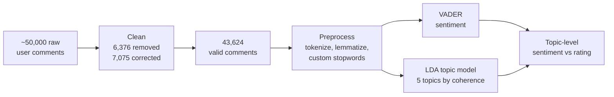

# Snapchat User Reviews: Topic Modelling & Sentiment Insights

**Star ratings said users were happy. Their words said otherwise.**

`Data cleaning / ETL` · `Sentiment analysis` · `Topic modelling` · `Product recommendations`
Carleton University, TIMG 5301 (Applied Analytics for Technology Management) · Fall 2025 · Team of 5

---

## Business question

What do Snapchat users complain about and value most, and does the star rating tell the full story?

## Data pipeline

| Cleaning step | Comments |
|---|---|
| Non-English removed | 2,879 |
| Spam / off-topic removed | 1,860 |
| Emoji-only removed | 1,542 |
| Unreadable removed | 95 |
| Emoji or spelling corrected (kept) | 7,075 |

## Choosing the model

Models of up to 14 topics were compared on topic coherence, Kruskal stress and log perplexity. **5 topics** gave the best balance of coherence and interpretability.

## The five topics

| # | Topic | Top terms | Signal |
|---|---|---|---|
| 1 | Technical issues & device performance | camera, wide, android, update, fix | Pain point |
| 2 | Creative features & positive experience | love, filter, chat, photo, video | Strength |
| 3 | Ads, notifications & UX annoyances | ad, story, notification, stop, annoying | Pain point |
| 4 | Account, login & support problems | account, reason, worst, nothing | Pain point |
| 5 | Social connection & positive usage | friend, fun, call, great | Strength |

## Key insight: ratings mask complaints

Topic 1 averaged **~3.6–3.8 stars** but a sentiment score of only **~0.10–0.15**. Users rated 4–5 stars while writing about bugs and asking for fixes. **Topic-level sentiment is a better early warning than star ratings.**

## Recommendations

1. Fix camera reliability on Android, including wide-angle support
2. Reduce ad intrusiveness and notification overload
3. Explain account locks and bans clearly, with a faster support path
4. Invest in the creative and social features users love most

## My role
- Literature research and analytical framework design
- Data cleaning and preprocessing
- Model selection by topic coherence; topic labelling and interpretation
- Deep dive with LDAvis, word clouds and concordance analysis
- Trends, findings, recommendations, and presenting to the class

**Team:** Ba Khanh Huyen Nguyen, Bhabna Mukherjee, Farah Mutahhara, Milena Sajjan, Thuong Tran · Supervised by Dr. Mika Westerlund

## Files
- [`report/`](report/): full final report (PDF)
- Charts in the repository root

**Tools:** Orange Data Mining · VADER · LDA · LDAvis · MDS
